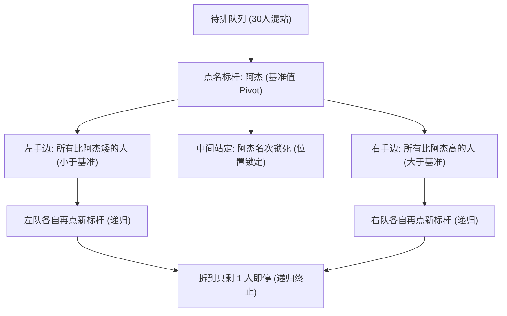

# 视觉与可交互同构脚手架（Visual & Interactive Scaffolds）

当目标知识涉及**多节点并发状态机**（如 Raft、TCP 握手、HTTP 缓存校验）、**连续空间/概率几何变换**（如贝叶斯更新面积比、梯度下降曲面、自注意力矩阵加权）或**树形递归分治**（如快速排序、二分查找）时，纯文字比喻容易遭遇读者的工作记忆瓶颈。此时可在自然叙事之外，叠加**同构图表（Mermaid）**或**可交互探索微件（Explorable Explanation Widget）**。

## 核心铁律：视觉与交互必须同构，拒绝装饰性配图

1. **一图一机制，严禁信息冗余**：图表或交互控件不是插画。图中的每一个节点、箭头或滑块，都必须与 `
` 四列映射表中的 `知识概念 | 类比/视觉元素 | 对应机制 | 适用边界` 一一对应。
2. **先看阻碍，再看流向**：状态图与时序图必须标出**「卡点/拒绝分支」**（例如：票数未过半时停留在候选态、分母为零时禁止触发更新），不能只画顺风顺水的成功路径。
3. **正文独立可读**：即使剥离代码块（或在纯文本终端阅读），正文依然必须是一篇逻辑闭环、段落饱满的自然叙事；`check-output` 在统计正文字数、段落句数与无标点长句时会自动跳过代码块，并对 `mermaid` 块执行语法门禁校验。

## 模式一：同构 Mermaid 图表规范

仅使用受支持的 표준 Mermaid 语法（`flowchart TD/LR`、`sequenceDiagram`、`stateDiagram-v2`、`xychart-beta`），严禁在节点标签内使用 ` ` 等 HTML 标签（`check-output` 的 `validateMermaidBlocks` 会拦截含 HTML 标签或非法声明的图表）。

### 适用题型与图种映射

| 机制形态 | 推荐图种 | 必画的同构要素 |
|---|---|---|
| 并发通信与协议握手（TCP、HTTP 缓存、Raft 复制） | `sequenceDiagram` | 发起方、响应方、报文携带的凭证、超时或拒绝分支 |
| 状态流转与选主容错（Raft 选举、熔断器、锁状态） | `stateDiagram-v2` | 初始状态、触发转移的阈值条件（如 `票数 > N/2`）、故障回退路径 |
| 分治递归与条件分流（快速排序、二分查找、决策树） | `flowchart TD` | 标杆/中点切分动作、左右子区间去向、递归终止叶子节点 |

### 示例（快速排序首轮分区同构图）

## 模式二：可交互探索微件（Explorable Explanations）

当宿主环境支持渲染单文件 HTML/SVG 微件（或用户要求「做个可交互演示」「让我能调参数试试」）时，遵循 Bret Victor 的 **Explorable Explanations（可探索解释）** 范式：

1. **控件即自变量，画面即后验结果**：
   - **贝叶斯更新**：提供「先验怀疑度 $P(A)$」「真凶留印率 $P(B|A)$」「路人撞款率 $P(B|\neg A)$」三个滑块，实时渲染真假阳性面积占比，并在分母归零时置灰报警。
   - **梯度下降**：提供「步长（学习率）」滑块与「迈出一步」按钮，让读者亲手调大步长看到小球在山谷两侧震荡发散，直观理解「步长过大越过谷底」的适用边界。
   - **CAP 权衡**：提供「剪断跨机房网线（触发分区 P）」开关，让读者直观看到「强行要求两地账本一致（C）就必须挂起写请求（牺牲 A）」的硬性约束。
2. **映射表同步记录控件边界**：在四列映射表的「类比元素」列写明交互控件名称，在「适用边界」列写明滑块推到极值时的物理/数学失效边界。
